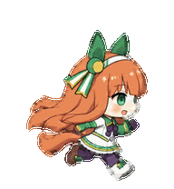
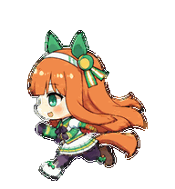
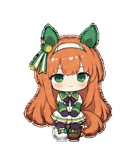
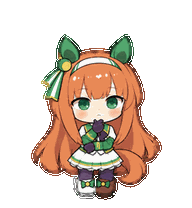
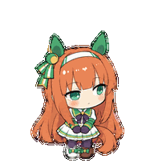
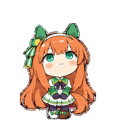
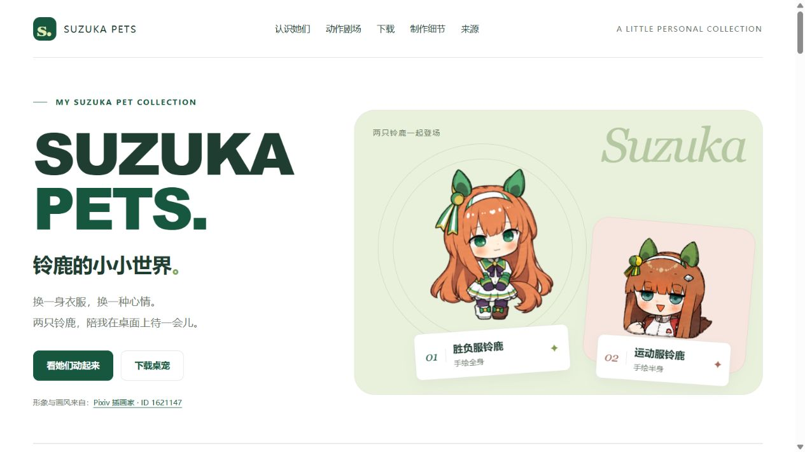
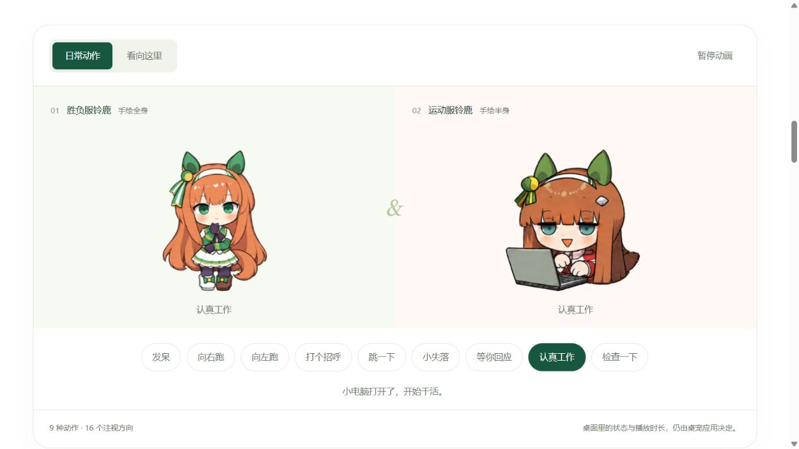

SUZUKA PETS · PERSONAL ART COLLECTION

<h1 align="center">铃鹿的小小世界</h1>

换一身衣服，换一种心情。 两只手绘铃鹿，陪你在桌面上待一会儿。

<b>02 款桌宠 &nbsp; / &nbsp; 各 09 种动作 &nbsp; / &nbsp; 各 16 个注视方向</b>

<a href="#认识她们">认识她们</a> &nbsp; · &nbsp; <a href="#动作剧场">动作剧场</a> &nbsp; · &nbsp; <a href="#网站预览">网站预览</a> &nbsp; · &nbsp; <a href="#下载与收藏">下载收藏</a> &nbsp; · &nbsp; <a href="#创作与来源">创作来源</a>

## 认识她们

<table>
<tr>
<td align="center" width="50%">RACE OUTFIT · FULL BODY<h3>胜负服铃鹿</h3>
站着时安安静静，跑起来时，长发和裙摆也跟着动。

<b>v1.3</b> · <a href="pets/suzuka-race-outfit-fullbody-handdrawn/README.md">走近这只铃鹿</a> · <a href="https://github.com/MIBXR/suzuka-pets/releases/download/v1.3-suzuka-race-outfit-fullbody-handdrawn/suzuka-race-outfit-fullbody-handdrawn-portable.zip">下载 ZIP</a>
</td>
<td align="center" width="50%">TRACKSUIT · HALF BODY<h3>运动服铃鹿</h3>
慢慢眨眼，敲敲键盘，再等你说下一句话。

<b>v1.3</b> · <a href="pets/suzuka-tracksuit-halfbody-handdrawn/README.md">走近这只铃鹿</a> · <a href="https://github.com/MIBXR/suzuka-pets/releases/download/v1.3-suzuka-tracksuit-halfbody-handdrawn/suzuka-tracksuit-halfbody-handdrawn-portable.zip">下载 ZIP</a>
</td>
</tr>
</table>

**胜负服全身款**保留绿白裙装、深紫手套和两条耳饰飘带。完整的身体轮廓让跑步与跳跃更轻盈，安静站着时则带着温柔的神情。

**运动服半身款**换成红白外套，留着半眯绿眼和三角形小笑嘴。她会敲敲灰绿色小电脑，等待时，头发旁的三个小点也陪着她。

## 动作剧场

两款都完整展示九种日常动作与十六方向注视。这里的 GIF 取自各自的成品图集；点击动图可单独查看。

### 01 · 胜负服铃鹿

<table>
<tr>
<td align="center" width="33%"><b>01 · 待机</b>  安静站好，轻轻眨眼。</td>
<td align="center" width="33%"><b>02 · 向右跑</b>  迈开小步，长发向后跟随。</td>
<td align="center" width="33%"><b>03 · 向左跑</b>  换个方向，继续向前跑。</td>
</tr>
<tr>
<td align="center" width="33%"><b>04 · 挥手</b>  身体站稳，抬手打个招呼。</td>
<td align="center" width="33%"><b>05 · 跳跃</b>  蓄力、腾空，再轻轻落下。</td>
<td align="center" width="33%"><b>06 · 失落</b>  耳朵垂下，低头后慢慢恢复。</td>
</tr>
<tr>
<td align="center" width="33%"><b>07 · 等待回应</b>  双手靠近胸前，歪头等你。</td>
<td align="center" width="33%"><b>08 · 工作</b>  双手收在胸前，专心处理事情。</td>
<td align="center" width="33%"><b>09 · 检查与思考</b>  微微歪头，用目光认真查看。</td>
</tr>
</table>

<table>
<tr>
<td align="center" width="33%"><b>10 · 十六方向注视</b> </td>
<td><b>抬头、转向，再低头看看。</b>  身体、双手与双脚保持相同落点，头部逐步俯仰、转向；脸部、眼睛和发饰随姿态一起变化。  GIF 从上方开始，按顺时针依次展示 16 个方向。实际跟随与动作触发由桌宠应用决定。</td>
</tr>
</table>

[看她的动作设计](pets/suzuka-race-outfit-fullbody-handdrawn/creation/README.md) · [翻看高清原稿](pets/suzuka-race-outfit-fullbody-handdrawn/materials/)

### 02 · 运动服铃鹿

<table>
<tr>
<td align="center" width="33%"><b>01 · 待机</b>  半眯绿眼，慢慢眨一下。</td>
<td align="center" width="33%"><b>02 · 向右移动</b>  小手向前，长发随移动摆动。</td>
<td align="center" width="33%"><b>03 · 向左移动</b>  朝左伸出小拳头，发饰保持原位。</td>
</tr>
<tr>
<td align="center" width="33%"><b>04 · 挥手</b>  抬起手掌，轻轻挥一挥。</td>
<td align="center" width="33%"><b>05 · 跳跃</b>  整个小上身轻轻跳起来。</td>
<td align="center" width="33%"><b>06 · 失落</b>  耳朵垂下来，低头缓一缓。</td>
</tr>
<tr>
<td align="center" width="33%"><b>07 · 等待回应</b>  三个小点亮起，安静等你回应。</td>
<td align="center" width="33%"><b>08 · 工作</b>  守着灰绿色小电脑，交替敲键盘。</td>
<td align="center" width="33%"><b>09 · 检查与思考</b>  一只手托腮，认真想一想。</td>
</tr>
</table>

<table>
<tr>
<td align="center" width="33%"><b>10 · 十六方向注视</b> </td>
<td><b>抬头、转向，再低头看看。</b>  下方衣领与小身体保持稳定，利用整张脸的俯仰、转向表现视线，同时保留左右发饰与半眯眼的结构。  GIF 从上方开始，按顺时针依次展示 16 个方向。实际跟随与动作触发由桌宠应用决定。</td>
</tr>
</table>

[看她的动作设计](pets/suzuka-tracksuit-halfbody-handdrawn/creation/README.md) · [翻看高清原稿](pets/suzuka-tracksuit-halfbody-handdrawn/materials/)

## 网站预览

独立的展示网站把两款铃鹿放在同一个小世界里：认识角色、切换九种动作、让视线跟随指针，或把喜欢的一款带回桌面。

展开动作剧场预览

[网站介绍与两张页面预览](site/README.md) · [完整网站源码与素材](site/)

截图来自仓库中的当前网页。网站保存自己的页面、图片、动作条带和下载包，可以作为完整的网站作品单独浏览与更新。

## 下载与收藏

| 作品 | 当前版本 | 成品下载 | 制作收藏 |
| --- | --- | --- | --- |
| 无声铃鹿 · 胜负服全身手绘 | [v1.3](https://github.com/MIBXR/suzuka-pets/releases/tag/v1.3-suzuka-race-outfit-fullbody-handdrawn) | [便携 ZIP](https://github.com/MIBXR/suzuka-pets/releases/download/v1.3-suzuka-race-outfit-fullbody-handdrawn/suzuka-race-outfit-fullbody-handdrawn-portable.zip) · [解包成品](pets/suzuka-race-outfit-fullbody-handdrawn/package/README.md) | [参考与提示词](pets/suzuka-race-outfit-fullbody-handdrawn/creation/README.md) · [高清原稿](pets/suzuka-race-outfit-fullbody-handdrawn/materials/) |
| 无声铃鹿 · 运动服半身手绘 | [v1.3](https://github.com/MIBXR/suzuka-pets/releases/tag/v1.3-suzuka-tracksuit-halfbody-handdrawn) | [便携 ZIP](https://github.com/MIBXR/suzuka-pets/releases/download/v1.3-suzuka-tracksuit-halfbody-handdrawn/suzuka-tracksuit-halfbody-handdrawn-portable.zip) · [解包成品](pets/suzuka-tracksuit-halfbody-handdrawn/package/README.md) | [参考与提示词](pets/suzuka-tracksuit-halfbody-handdrawn/creation/README.md) · [高清原稿](pets/suzuka-tracksuit-halfbody-handdrawn/materials/) |

便携包包含 sprite v2 正式图集、必要的桌宠信息和逐动作 GIF。[全部发布](https://github.com/MIBXR/suzuka-pets/releases)中可以找到各款的其他版本，对应提交保留当时的作品与制作资料。

## 创作与来源

这个收藏从角色与插画参考出发，用 Codex 和 AI 生图辅助制作动作，保留采用的提示词、高清生成原稿与最终成品。每款作品都可以沿着“参考 → 动作想法 → 原稿 → 成品”的顺序阅读。

角色来自[《赛马娘 Pretty Derby》](https://umamusume.jp/character/silencesuzuka)。两款桌宠的形象与画风参考保留署名：[Pixiv 插画家 · ID 1621147](https://www.pixiv.net/users/1621147)。桌宠通过 AI 辅助生成与后续整理制作；角色及参考插画的权利归原权利人。
