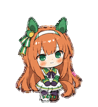
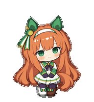

# Suzuka Pets

两款无声铃鹿手绘桌宠：轻盈的胜负服全身形象，与适合伏案陪伴的运动服半身形象。

## 无声铃鹿 · 胜负服全身手绘

栗色长发、碧绿眼眸与绿白胜负服。保留两条飘带耳饰，以柔和配色和手绘线条表现安静、轻盈的无声铃鹿。

 

**v1.3** · [作品与动作](pets/suzuka-race-outfit-fullbody-handdrawn/) · [制作记录](pets/suzuka-race-outfit-fullbody-handdrawn/creation/README.md) · [高清原稿](pets/suzuka-race-outfit-fullbody-handdrawn/materials/) · [下载便携包](https://github.com/MIBXR/suzuka-pets/releases/tag/v1.3-suzuka-race-outfit-fullbody-handdrawn)

## 无声铃鹿 · 运动服半身手绘

以运动服和半身构图表现无声铃鹿。保留长发、耳饰与温柔神情，让眨眼、挥手和伏案工作成为桌面上的小动作。

 

**v1.3** · [作品与动作](pets/suzuka-tracksuit-halfbody-handdrawn/) · [制作记录](pets/suzuka-tracksuit-halfbody-handdrawn/creation/README.md) · [高清原稿](pets/suzuka-tracksuit-halfbody-handdrawn/materials/) · [下载便携包](https://github.com/MIBXR/suzuka-pets/releases/tag/v1.3-suzuka-tracksuit-halfbody-handdrawn)

## 版本与来源

[全部版本](https://github.com/MIBXR/suzuka-pets/releases)记录每款宠物的发布。对应提交保存那个版本的制作资料与作品文件。

角色来自[《赛马娘 Pretty Derby》](https://umamusume.jp/character/silencesuzuka)。保留画风参考署名：[Pixiv 1621147](https://www.pixiv.net/users/1621147)。角色及参考作品权利归原权利人。
