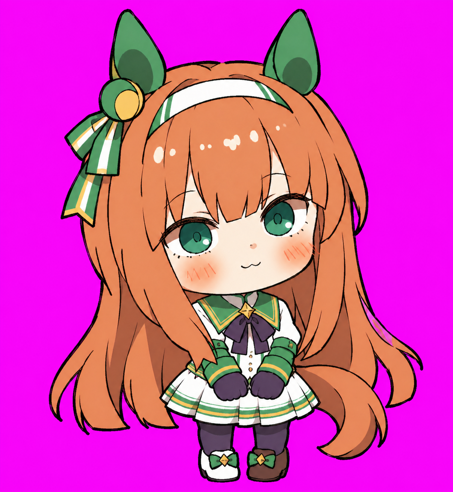

BEHIND THE PET

<h1 align="center">无声铃鹿 · 胜负服全身手绘 · 制作记录</h1>

从一张参考图，到桌面上的小动作。

<b>v1.3 &nbsp; / &nbsp; 参考 · 提示词 · 高清原稿 · 成品</b>

<a href="../README.md">看作品</a> &nbsp; · &nbsp; <a href="#动作设计与原稿">动作设计</a> &nbsp; · &nbsp; <a href="prompts/character.md">角色提示词</a> &nbsp; · &nbsp; <a href="../package/spritesheet.png">成品图集</a>

## 形象从哪里来

把熟悉的绿白胜负服缩成一只二头身小铃鹿。栗色长发、碧绿眼睛、深紫手套与两条耳饰飘带保留下来，柔和的配色和略带手感的线条，让她在桌面的一角也显得安静、轻盈。

角色来自[《赛马娘 Pretty Derby》](https://umamusume.jp/character/silencesuzuka)。两款桌宠的形象与画风参考保留署名：[Pixiv 插画家 · ID 1621147](https://www.pixiv.net/users/1621147)。桌宠通过 AI 辅助生成与后续整理制作；角色及参考插画的权利归原权利人。

<table>
<tr><td align="center" width="50%"><b>采用的主形象</b> </td><td align="center" width="50%"><b>成品中的日常姿态</b> </td></tr>
</table>

## 想保留下来的细节

**全身轮廓。** 大头、短身与完整双脚，跑步、起跳和落地都有清楚的身体动作。

**熟悉的细节。** 绿白胜负服、深紫蝴蝶结、两条耳饰飘带，以及不对称的鞋饰。

**克制的表情。** 待机眨眼、抬手招呼、低头失落，以小幅动作表达不同状态。

## 制作思路

先从参考中确定角色特征与手绘表达，保存[主形象提示词](prompts/character.md)和采用的角色主图。随后按动作分别生成连续姿态：日常动作保留各自的节奏，注视动作围绕同一套身体构图变化。

生成阶段的高清图保存在 `materials/`，对应提示词保存在 `prompts/`。作品经过透明处理、选帧、位置与配色调整后，成为 `package/` 中的最终图集；下表把每个动作的想法、原稿和最终表现放在一起。原稿保留生成时的状态，部分可见用于去背景的纯色底。

## 动作设计与原稿

| 动作与成品 | 制作思路 | 提示词与高清原稿 |
| :---: | --- | --- |
| **待机**  6 帧 | 让睁眼、闭眼、重新睁眼形成自然循环；其他部位保持安静，让待机成为整套动作的视觉参照。 | [提示词](prompts/idle.md) [高清原稿](../materials/idle.png) |
| **向右跑**  8 帧 | 以向右的完整跑姿表现移动，发尾、尾巴与裙摆跟随步态，保持全身轮廓可读。 | [提示词](prompts/running-right.md) [高清原稿](../materials/running-right.png) |
| **向左跑**  8 帧 | 保存独立的向左跑姿，沿用服装与耳饰细节，让两个移动方向都能辨认角色。 | [提示词](prompts/running-left.md) [高清原稿](../materials/running-left.png) |
| **挥手**  4 帧 | 头、肩、胸前饰物和双脚保持固定，只让连接在肩部的手臂抬起、摆动，再回到胸前。 | [提示词](prompts/waving.md) [高清原稿](../materials/waving.png) |
| **跳跃**  5 帧 | 从站立到起跳、腾空和落地，用身体位移表达跳跃，保持头身大小一致。 | [提示词](prompts/jumping.md) [高清原稿](../materials/jumping.png) |
| **失落**  8 帧 | 耳朵下垂、头部低下、闭眼停顿，再恢复站姿；情绪来自姿态变化，保留原有柔和配色。 | [提示词](prompts/failed.md) [高清原稿](../materials/failed.png) |
| **等待回应**  6 帧 | 以胸前双手、小幅歪头和眨眼表现期待回应，动作节奏保持轻缓。 | [提示词](prompts/waiting.md) [高清原稿](../materials/waiting.png) |
| **工作**  6 帧 | 双手靠近胸前，目光移动并穿插眨眼，表现专注处理任务的状态；此款采用无额外道具的姿态。 | [提示词](prompts/running.md) [高清原稿](../materials/running.png) |
| **检查与思考**  6 帧 | 用小幅歪头、左右查看和一次眨眼表现检查，双手保持稳定，让注意力落在神情上。 | [提示词](prompts/review.md) [高清原稿](../materials/review.png) |
| **十六方向注视**  16 个方向姿态 | 身体、双手与双脚保持相同落点，头部逐步俯仰、转向；脸部、眼睛和发饰随姿态一起变化。从上方起，按每 22.5° 顺时针排列。 | [前八方向提示词](prompts/look-row-9.md) [前八方向原稿](../materials/look-row-9.png) [后八方向提示词](prompts/look-row-10.md) [后八方向原稿](../materials/look-row-10.png) |

## 参考收藏

### 角色与画风

- [角色参考原图](references/reference-01.png)
- [采用的角色主形象](references/canonical-base.png)

### 注视设计

- [采用的方向姿态参考](references/look-anchors-approved.png)

## 当前作品

v1.3 采用重新绘制的挥手原稿：保留待机的脸型与配色，固定肩部和身体位置，让招呼集中在手臂的小幅摆动上。

[看完整作品](../README.md) · [高清原稿](../materials/) · [解包成品](../package/README.md)
