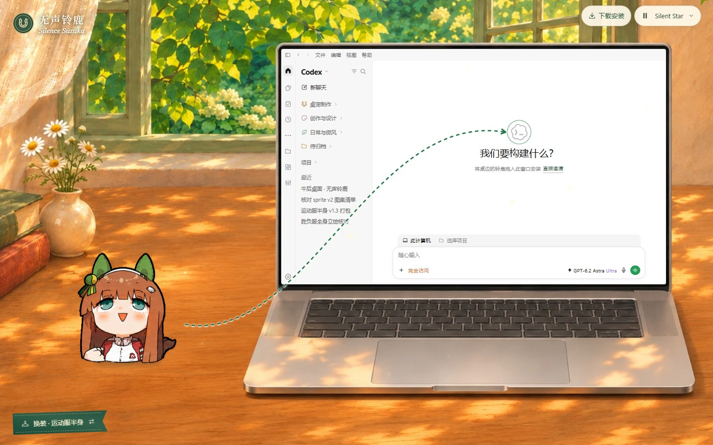
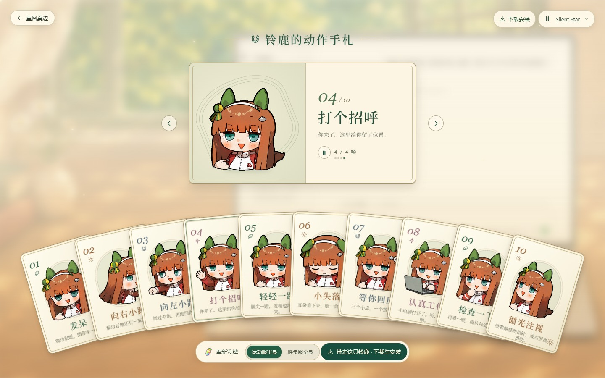
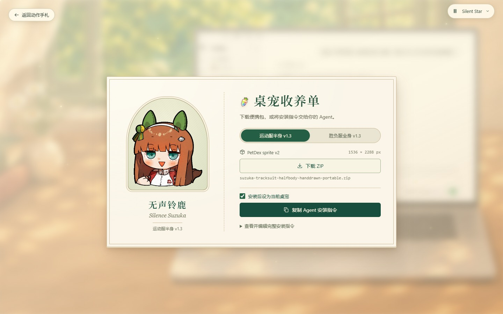

SUZUKA PETS · THE WEBSITE

<h1 align="center">无声铃鹿的午后桌边</h1>

<a href="../README.md">作品首页</a> &nbsp; · &nbsp; <a href="#页面预览">页面预览</a> &nbsp; · &nbsp; <a href="#本地浏览">本地浏览</a> &nbsp; · &nbsp; <a href="#网站文件">网站文件</a>

## 页面预览

暖米色开场里，《赛马娘》的 Jewel 萝卜图标标出当前的音乐选项。选「开启音乐」会伴着《Silent Star》进入桌边，也可以选「关闭音乐」安静入场。桌面右上角的播放器可以暂停，或换成《Endless Dream》。

### 午后桌边

默认的铃鹿穿红白运动服，是 v1.3 半身款。点「换装」可以换成同版本的胜负服全身款。把铃鹿拖进笔记本屏幕，或点「直接邀请」，模拟的 Codex 会输入简短的安装指令，读取对应 ZIP，再询问是否允许写入。选择「拒绝」可以重试或回桌边。选择「允许」会打开动作手札。实际安装使用收养单中的 ZIP 或 Agent 指令。

### 动作手札

十张牌摊在桌上。九张各有一段可暂停的高清动作，最后一张「循光注视」可以随指针、触摸或方向键在十六个方向间转动。点一张牌或使用两侧箭头即可切换动作。「重新发牌」会打乱整手牌。两款装束可以在手札底部切换。

### 桌宠收养单

从桌面右上角点「下载安装」，或在动作手札中点「带走这只铃鹿」，都能翻开这张收养单。选好装束可直接下载便携 ZIP。要让 Agent 安装，先选定是否「安装后设为当前桌宠」，再点「复制 Agent 安装指令」。完整指令可以展开编辑。

安装指令列出了 Codex、兼容 Agent 与 PetDex 的桌宠目录和启用选项。目录和配置见 [Codex 桌宠约定](https://github.com/openai/skills/blob/main/skills/.curated/hatch-pet/references/codex-pet-contract.md)和 [PetDex CLI 文档](https://github.com/crafter-station/petdex/blob/main/packages/petdex-cli/README.md)。

## 本地浏览

在仓库根目录运行 `python -m http.server 8000`，然后打开 [本地午后桌边](http://127.0.0.1:8000/site/)。也可以把整个 `site/` 目录放到 HTTPS 静态主机的根目录或子目录。

## 网站文件

| 文件或目录 | 用途 |
| --- | --- |
| [index.html](index.html) · [styles.css](styles.css) | 开场、桌景、笔记本里的 Codex 和公共控件。 |
| [app.js](app.js) | 拖动与换装、安装模拟、场景切换。 |
| [gallery.js](gallery.js) · [gallery.css](gallery.css) | 动作手札、选牌、重新发牌、动作播放与注视罗盘。 |
| [folio.js](folio.js) · [folio.css](folio.css) | 收养单、装束选择、下载入口和安装指令复制。 |
| [packages.js](packages.js) · [downloads/](downloads/) | 两个便携 ZIP、安装清单、安装指令与模拟用的包校验。 |
| [sprites.js](sprites.js) · [assets/motion-hd/](assets/motion-hd/) | 读取高清动作条带和帧坐标，绘制两款装束。 |
| [music.js](music.js) · [assets/audio/](assets/audio/) | 两首背景音乐及播放、切换控制。 |
| [assets/desk/](assets/desk/) | 横版、超宽版和竖版桌景，以及[桌景生成提示词](assets/desk/SOURCES.md)。 |
| [icons.svg](icons.svg) · [favicon.ico](favicon.ico) · [assets/icons/](assets/icons/) · [assets/official/](assets/official/) | 控件图标、浏览器标签页图标与 Jewel 萝卜图标。 |
| [preview.jpg](preview.jpg) · [preview-motion.jpg](preview-motion.jpg) · [preview-folio.jpg](preview-folio.jpg) | 1440 × 900 的桌景、动作手札和收养单截图。 |

## 角色与参考

无声铃鹿出自《赛马娘 Pretty Derby》。角色、Jewel 图标以及《Silent Star》《Endless Dream》的权利归各自权利人。两款桌宠的造型和画风参考了 Pixiv 插画家 ID 1621147 的作品，参考插画的著作权归原作者。[官方角色介绍](https://umamusume.jp/character/silencesuzuka) · [插画家主页](https://www.pixiv.net/users/1621147)

[胜负服桌宠](../pets/suzuka-race-outfit-fullbody-handdrawn/README.md) · [运动服桌宠](../pets/suzuka-tracksuit-halfbody-handdrawn/README.md)
